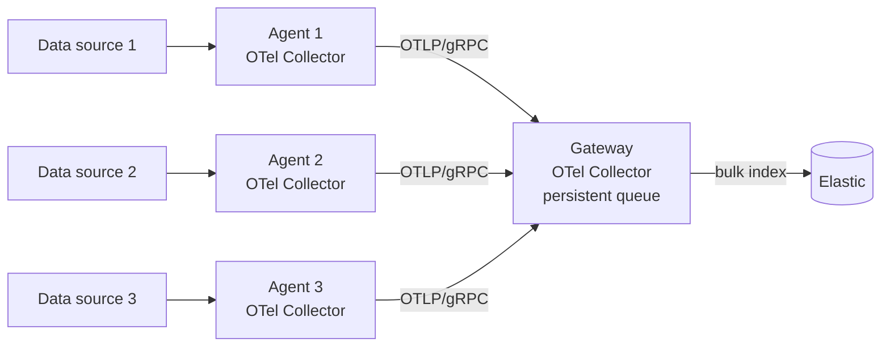
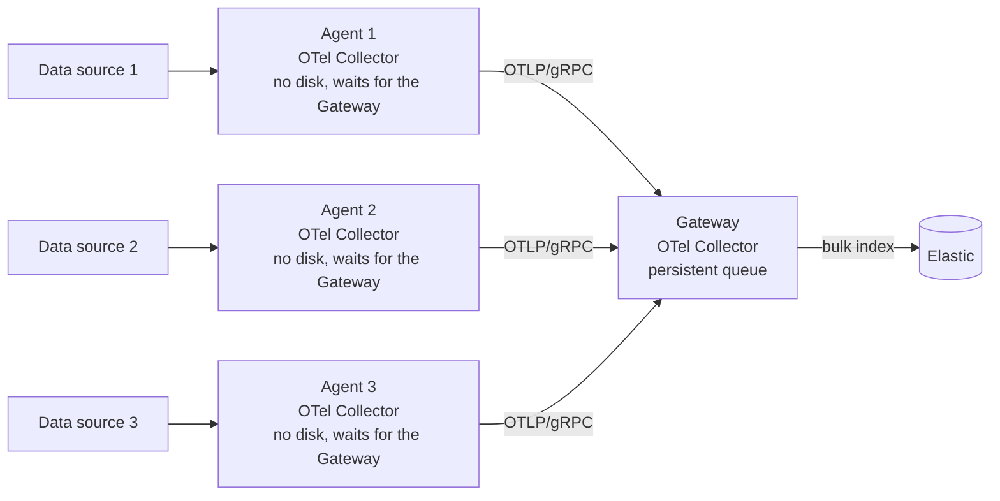
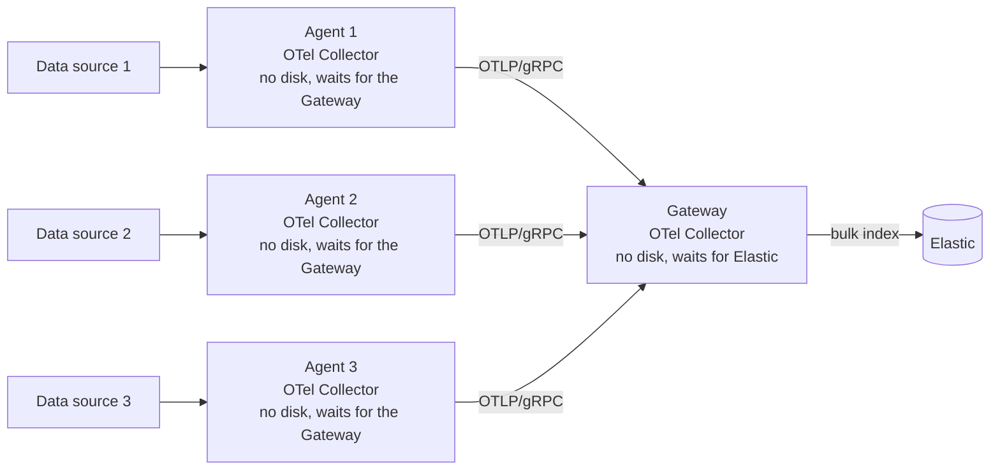
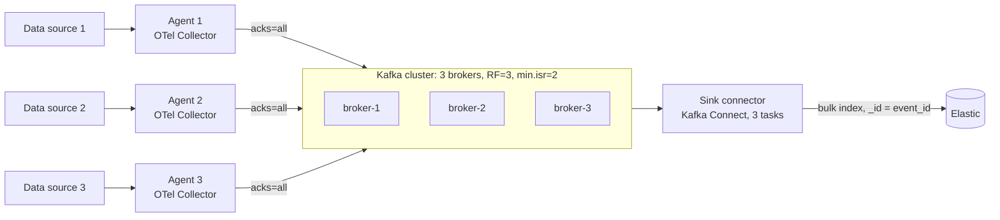
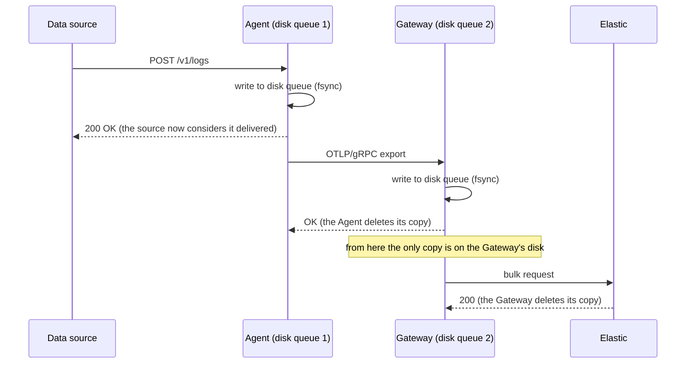
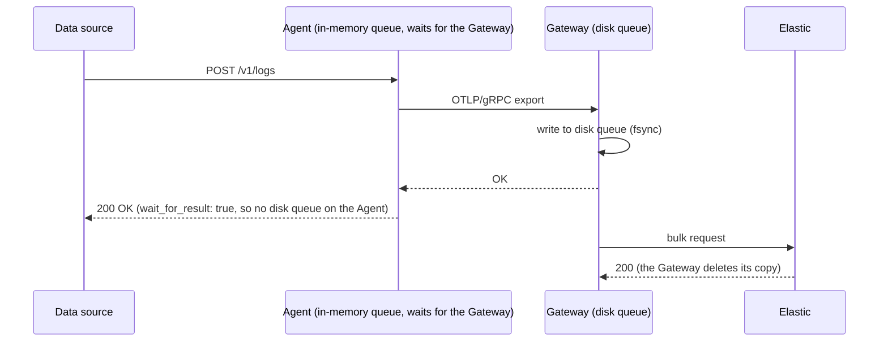
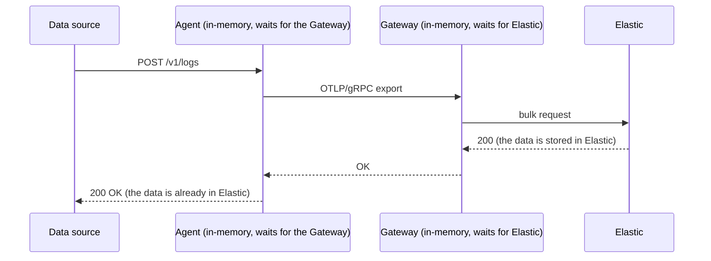
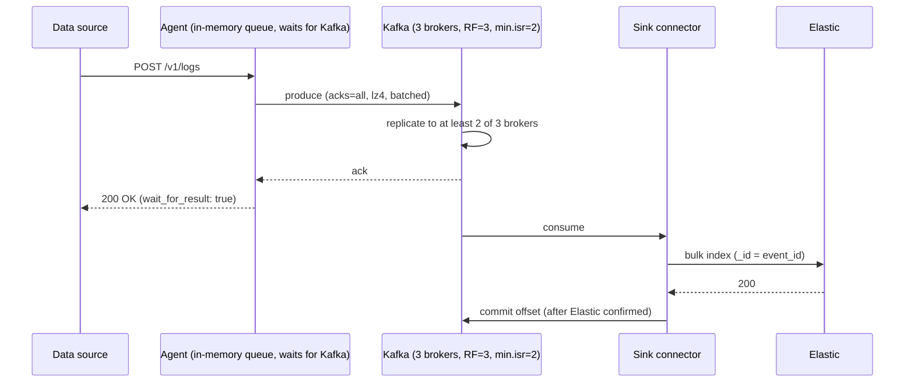

# OpenTelemetry end to end vs. Kafka in the middle

## Does putting Kafka between the OTel Agents and Elastic make telemetry delivery more resilient?

This demo measures it. The same data sources send the same logs through four setups (three variants of OTel end to end, and Kafka in the middle), the same failure is injected, and every event is counted at the end. Four kinds of failure are tested: the middle tier loses its disk, Elastic is unavailable for about a minute (killed, or frozen), and a Kafka Connect worker is killed. Each event has a unique ID and a ground-truth ledger, so loss and duplication are counted, not estimated.

## Summary of what the demo shows

Measured at 15,000 events/s, three runs per scenario (two for the frozen-Elastic scenarios). The faults: in the `-kill` scenarios the middle tier (the Gateway, or a Kafka broker) is killed and its disk wiped five times per run; in the `-es-kill` scenarios Elastic is killed and stays down for about a minute (65-66 s); in the `-es-pause` scenarios Elastic is frozen for about a minute (it keeps its address, requests time out); in `otel-kafka-connect-kill` one of two Kafka Connect workers is killed.

- **An acknowledgement is a promise about who holds the data.** When a data source is told "OK", something has taken responsibility for its data: the Agent's disk (`otel-e2e`), the Gateway's disk (`otel-e2e-sync`), Elastic itself (`otel-e2e-stateless`), or three replicated Kafka brokers (`otel-kafka`).
- **A single disk loses acknowledged data.** When the Gateway's disk was destroyed, the two scenarios where the Gateway answers from its own disk lost 1.1%-1.8% of the acknowledged events (about 2,000-3,200 per disk loss, roughly 200 ms of traffic). Kafka and the stateless chain lost nothing. A shorter batching window, or storage that survives a disk failure, would reduce the OTel loss.
- **When Elastic is unavailable, the designs differ in where the backlog goes.** With Kafka the sources were never slowed (p99 acknowledgement 0.26 s) and nothing was lost; the topic held the backlog. The OTel scenarios with a disk queue also kept the sources fast. They lost nothing when Elastic was frozen, but lost 0%-1.2% of acknowledged events when Elastic was killed: the Gateway dropped batches after a name-resolution error. The stateless chain lost nothing either, but its sources were blocked for about a minute.
- **Repeated writes happen on every path that retries.** With the same document ID on both paths, a repeat never creates a second document in Elastic, but it is still sent and refused. Measured with Elastic's own counters, the extra writes while Elastic was frozen were 6.83%-6.90% of acknowledged events for the stateless chain and 0.56%-0.89% for Kafka (the sink retried requests that timed out), and 1.50%-3.22% for Kafka after a Connect worker was killed (the tasks of the killed worker re-read records since their last offset commit). On a platform that charges for throughput these are an extra cost.
- **Kafka keeps the data.** A new consumer group can re-read the retained topic, for example to rebuild an index (a retention demo, not a failure test). In the demo a second connector did that into a new index and all 895,500 acknowledged events arrived there. A chain of Collector queues keeps no copy of data once it is delivered.
- **Kafka's costs.** A cluster and a connector to operate, and a failover pause: with failure detection set to 3 seconds, the p99 latency in the broker-kill runs was 3.2-5.3 s, against 0.4 s without a failure.
- **What it does not show.** Fan-out and stream processing with Flink are described below but not demonstrated. The results come from one host, one event rate and a handful of faults, with 2-3 runs each.

Where to find what: [the scenarios](#the-scenarios), [how acknowledgements work](#how-acknowledgements-work), [how Kafka is set up](#how-kafka-is-set-up-and-why), [the faults](#the-tested-scenarios-and-faults), [how to run it](#run-it), [the results](#results), [what Kafka adds](#what-kafka-adds-beyond-fewer-lost-events), [limitations](#scope-and-limitations).

## The comparison at a glance

| | `otel-e2e` | `otel-e2e-sync` | `otel-e2e-stateless` | `otel-kafka` |
|---|---|---|---|---|
| Path | source, Agent, Gateway, Elastic | source, Agent, Gateway, Elastic | source, Agent, Gateway, Elastic | source, Agent, Kafka, sink connector, Elastic |
| The source gets its "OK" after | the **Agent** wrote the data to **its own disk** | the **Gateway** wrote the data to **its disk** | **Elastic** confirmed the write | **Kafka** replicated the data (`acks=all`, `min.insync.replicas=2`) |
| Does the Agent hold acked data? | yes, on disk, until the Gateway answers | no | no | no |
| Where acked data lives next | Agent disk, then Gateway disk | Gateway disk | nowhere in between: it is already in Elastic | at least 2 of the 3 brokers when acked (replication factor 3, `min.insync.replicas=2`) |
| If the middle tier loses a disk | the acked data on the Gateway's disk is lost | the acked data on the Gateway's disk is lost | no loss: nothing acked is held; requests in flight are not acked and are retried, which delivers them twice (Elastic rejects the repeat) | if one broker loses its disk, the other replicas still have the data |
| If the whole middle tier is unavailable | the Agent keeps absorbing data (until its queue is full) | the sources wait | the sources wait | the sources wait |
| If Elastic is unavailable for about a minute | the sources are not slowed; the Gateway holds the backlog on its disk (it lost nothing when Elastic was frozen, and dropped batches when a killed Elastic's name stopped resolving) | the same | the sources are blocked until Elastic returns, and the chain retries | the sources are not slowed; the topic holds the backlog and the sink delivers it when Elastic returns |

Held equal in all four: the same load (15,000 events/s in total, from three data sources, each paired with its own Agent), the same batching (200 ms or 5,000 events) wherever a component batches, comparable retry to Elastic (Gateway and sink connector: 1000 attempts), the same document ID on both paths (`_id = event_id`, so a repeated delivery never creates a second document), the same way of counting repeated writes (Elastic's own counters), and the same faults: in the `-kill` scenarios five total disk losses of the middle tier, 10 seconds apart, with Elastic healthy; in the `-es-kill` and `-es-pause` scenarios Elastic killed, or frozen, for about a minute.

`otel-e2e-sync` is the closest comparison with Kafka: in both, the source is told "OK" only after the middle tier has the data durably. It is not identical: what the middle tier is (one Gateway disk or a replicated Kafka log), the components downstream of it (Gateway exporter or sink connector) and what is carried (see "The data") still differ. `otel-e2e-stateless` goes one step further: nothing is stored anywhere in the OTel chain, so an acknowledged event is already in Elastic. The trade-off is that every source request waits for Elastic, so latency and availability are tied to Elastic.

## Terminology

| Term | Meaning |
|---|---|
| **Data source** | A Python process that creates log events (and a metric) and sends them over OTLP/HTTP. Three data sources run in parallel, each in its own process: `source-1..3`. |
| **OTel Collector** | The software (`otelcol-contrib`). The same binary plays every role below. |
| **Agent** | An OTel Collector next to one data source (one Agent per source). `agent-otel-N` or `agent-kafka-N`. |
| **Gateway** | A central OTel Collector that all Agents send to and that writes to Elastic. Only in the OTel scenarios. |
| **Kafka cluster** | 3 Confluent Platform brokers (KRaft), replication factor 3, `min.insync.replicas=2`. Only in the Kafka scenario. |
| **Sink connector** | The Kafka Connect Elasticsearch sink that copies the Kafka topic into Elastic. Only in the Kafka scenario. |
| **Elastic** | Elasticsearch (and Kibana), the destination in every scenario. |
| **Middle tier** | What sits between the Agents and Elastic: the Gateway in the OTel scenarios, the Kafka cluster in the Kafka scenario. |
| **OTLP** | OpenTelemetry's wire protocol for telemetry (here over HTTP from the sources and gRPC between Collectors). |
| **Persistent queue** | A buffer a Collector keeps on disk between receiving data and delivering it, so a restart does not lose it. A destroyed disk does. |
| **Batching** | Collecting events for a short time (here up to 200 ms or 5,000 events) so they are sent in fewer, larger requests. |
| **Replica, in-sync replica** | A copy of a Kafka partition on another broker; an in-sync replica is one that is fully caught up. |
| **Idempotent producer** | A Kafka producer feature that stops the producer's own retries from writing a record twice. It requires `acks=all`; the Collector's Kafka client (franz-go) enables it by default. |
| **Disk loss** | The fault injected in the `-kill` scenarios: the node is killed (`kill -9`) and the volume holding its data is wiped. |
| **Elastic outage** | The fault injected in the `-es-kill` scenarios (Elastic is killed with `kill -9`, stays down about a minute, 65-66 s measured, and is restarted; its data survives) and in the `-es-pause` scenarios (Elastic is frozen with `docker pause` for about a minute; it keeps its address and requests time out). |
| **Back-pressure** | What happens upstream while the destination cannot accept data: sources wait, a buffer fills, or data is dropped. |
| **Version conflict** | Elastic's answer (HTTP 409) when a document with the same `_id` is written again and already exists. The write is rejected and the stored document is unchanged. |
| **Acked** | The data source received a 2xx from its Agent: "someone owns this data now". |
| **Acked but lost** | Acked, but never arrived in Elastic. This is silent loss: the source will never resend it. |
| **Duplicate delivery** | A write that reached Elastic beyond the first one for an event, whether or not Elastic stored it twice. Counted with Elastic's own write counters (see "How loss is measured"). |

## The scenarios

### Scenario 1: OTel end to end (`otel-e2e`)



Every hop keeps a persistent on-disk queue (`file_storage`, `fsync: true`) and answers "OK" as soon as the data is on its own disk. Data waiting in a queue lives on one local disk.

### Scenario 1b: OTel end to end with a synchronous Agent (`otel-e2e-sync`)



Same components, with the Agents set up like the Kafka Agents: no disk, and the source is answered only after the Gateway has the data on its disk.

### Scenario 1c: OTel end to end with nothing stored (`otel-e2e-stateless`)



Nothing is stored on the Agents or on the Gateway. The source sends, the Agent relays to the Gateway, the Gateway relays to Elastic, and the acknowledgement follows the same path back only after Elastic has confirmed.

### Scenario 2: Kafka instead of the Gateway (`otel-kafka`)



The Agent answers its source only after Kafka confirms the write, so the data already lives on at least two brokers. The sink commits its Kafka offset only after Elastic accepted the data, and indexes with `_id = event_id`, so a replayed record cannot create a second document.

## How acknowledgements work

In plain terms: an "OK" does not mean the data reached Elastic, only that the next hop has taken responsibility for it. What that hop does with the data, and what happens if it fails, is what the scenarios compare. The first table is a reference for the Collector settings; the diagrams below show each scenario step by step.

### What the settings mean

| Setting (in `otel/*.yaml`) | Meaning |
|---|---|
| `sending_queue` with `storage: file_storage` and `fsync: true` | A persistent queue on disk between "accepted" and "delivered". `fsync` makes each write reach the disk. It protects data across a crash or restart, **not** against losing the disk itself. |
| `wait_for_result: true` | The incoming request is held until the next hop has answered. It cannot be combined with a disk queue, so a Collector that waits uses an in-memory queue: the Agents in `otel-e2e-sync` and `otel-e2e-stateless`, the Gateway in `otel-e2e-stateless`, and the Kafka Agents. |
| `retry_on_failure` with `max_elapsed_time: 0` | Retry a failed export forever (the default stops after 300 s and drops the data). Used on the Agents. |
| `block_on_overflow: true` | When a queue is full, make the sender wait instead of dropping. |
| `timeout: 120s` | Per-attempt wait on the Agents that wait for the next hop (`otel-e2e-sync`, `otel-e2e-stateless` and the Kafka Agents); the 5 s default would cancel in-flight requests during a failover. The `otel-e2e` Agent answers after its own disk write and uses the default. |
| Batching | The same in every component that batches (the Agents' exporters, the Gateway's exporter to Elastic, the sink connector): a batch is sent after 200 ms or 5,000 events, whichever comes first. It is the exporter's own `sending_queue.batch`; the legacy `batch` processor is not used (the only processor is `resource`). In the Collector source the exporter's queue sits in front of the batcher, so with a persistent queue each request is written to disk as it arrives and batched afterwards. See "Why 200 ms" below. |
| Gateway retry to Elastic | The Elasticsearch exporter has its own HTTP retry, set to 1000 attempts with a backoff of up to a minute, comparable to the sink connector's 1000 retries. It has no unlimited retry, and an error it does not retry makes the Gateway drop the batch (see "What the Collector does"). |
| Kafka `required_acks: -1`, `compression: lz4` | The producer waits for all in-sync replicas (the topic has `min.insync.replicas=2`); records are compressed. |
| Sink connector | `_id = event_id`, retried up to 1000 times, offset committed after Elastic accepts. |

### What the Collector does

- A Collector with a disk queue answers "OK" **as soon as the data is written to its own disk**, without waiting for the next hop.
- It deletes its copy only **after the next hop answered**.
- If it is killed, the queued items are replayed on restart (possible duplicates). If its **disk is destroyed, they are gone**.
- The Gateway writes to Elastic synchronously: it deletes an item after Elastic answers the bulk request.
- The Gateway's retry to Elastic is limited: 1000 attempts with a backoff of up to a minute, then the batch is **dropped from its queue, even though the Agent was already told OK**. A long Elastic outage can therefore lose data the Gateway had acknowledged. The Agents retry forever; the Gateway does not. In the `-es-kill` runs examined, the Gateway log shows "Exporting failed. Dropping data" with a name-resolution error (`lookup elasticsearch: no such host`, because the killed container's address disappears) on log batches of 3,000 to 4,000 events: those are the acknowledged events that were lost.

This follows the Collector v0.139.0 source (the version in the container).

### Scenario 1: a chain of hand-offs

Each hop answers "OK" once the data is on its own disk, and the sender deletes its copy only after that. Ownership moves one hop at a time.



**Why data is lost.** After the Gateway answers "OK" it still holds the data until Elastic confirms, and in between it waits up to 200 ms to fill a batch. During that whole time the only copy is on the Gateway's disk. A disk loss destroys everything acknowledged in that window, which is roughly the event rate times the batching window: about 3,000 events per disk loss at 15,000 events/s with a 200 ms window (measured: 2,000 to 3,200 per disk loss, from the totals of 10,000 to 16,000 lost per run). A killed process with an intact disk loses nothing, because the queue is replayed on restart.

**Why 200 ms.** It is the Collector's own default flush timeout (batch processor: 200 ms or 8,192 records, [README](https://github.com/open-telemetry/opentelemetry-collector/blob/main/processor/batchprocessor/README.md)), so it is a mild setting. Production Gateways often batch longer: Elastic suggests bulk requests of 5 to 15 MB as a starting point ([Elastic guide](https://www.elastic.co/guide/en/elasticsearch/guide/master/indexing-performance.html)), and the Elasticsearch exporter's own default is 10 seconds or 1 MB. The longer the window, the more acknowledged data a Gateway holds at risk. A shorter window reduces the exposure in proportion: without any waiting (a batch size below the request size, so every request is exported at once) the window shrinks to a few milliseconds and a disk loss usually finds nothing to destroy, at the cost of many small requests to Elastic, which is less typical for a production Gateway. The Kafka path uses the same setting, but its Agent answers only after Kafka has the data, so waiting for a batch exposes nothing.

### Scenario 1b: the same chain, answered synchronously



The Gateway's exposure window is the same as in scenario 1. What changes is that the Agent holds no second copy and the source's "OK" comes later.

### Scenario 1c: the acknowledgement comes back from Elastic



Both Collectors hold the request in memory and answer only when the next hop has. If Elastic fails, the Gateway returns an error to the Agent, the Agent retries (forever) while the source waits, and the source is never told "OK" for data that is not in Elastic. If a bulk request succeeded but its answer was lost, the retry sends it again; because the `_id` is the event ID, Elastic rejects it as a version conflict and stores nothing twice, but the data is still delivered twice. A Gateway killed mid-request loses nothing that was acknowledged. While Elastic is unavailable, the sources are blocked and the Agents and the Gateway keep retrying, so the same data is delivered many times once Elastic returns.

### Scenario 2: one hop, acknowledged by a replicated log



When the source is told "OK", the data is already on at least two brokers, and the Agent holds no acknowledged data that exists nowhere else. A failed produce is not acknowledged, so the source retries. Kafka's idempotent producer prevents duplicates from the Agent's own retries. A duplicate record can still enter the topic if a stall outlasts a source's 10 second request timeout, so the source resends the batch; the document `_id` then keeps Elastic free of the duplicate. None entered the topic in the measured runs.

### Other ways data is lost or duplicated

| Situation | Effect |
|---|---|
| The owner of the only copy loses its disk (the Gateway window above) | Loss, silent to the source |
| Retries are exhausted, or an error is not retried | Loss. The Agents retry forever; the Gateway retries 1000 times and then drops the batch, and drops it at once on an error its HTTP retry does not cover |
| A queue is full | With `block_on_overflow: true` the sender waits; without it, data is dropped |
| An "OK" is lost after the next hop stored the data | The sender retries: a repeated delivery (no second document, because the `_id` is the event ID) |
| The source never gets an "OK" and does not retry | Loss, but the source knows (counted as "never acked") |

## How Kafka is set up, and why

The Kafka cluster is 3 Confluent Platform brokers (`cp-server`, KRaft mode, no ZooKeeper). Each broker is also a KRaft controller, and the three form the controller quorum. The settings below are what makes an acknowledgement mean "the data is safe", and what keeps a broker loss from stopping the pipeline.

| Setting | Value | Why |
|---|---|---|
| Replication factor | 3 (topic `kafka-logs`, and the default for all topics, including Kafka's internal ones) | Every record lives on three brokers, so losing one broker, or one broker's disk, loses nothing. |
| `min.insync.replicas` | 2 | A write is acknowledged only when at least 2 replicas have it, and writes keep being accepted with one broker down. With 3 replicas and a minimum of 2, one failure is tolerated without losing data or availability. |
| Unclean leader election | disabled | A replica that is behind is never promoted to leader, so a failover cannot discard acknowledged records. |
| Partitions | 6 on `kafka-logs` | Spreads the load over the brokers and allows up to 3 sink connector tasks to read in parallel. |
| Retention | 7 days | The topic is a replayable log; consumers can re-read anything within the retention window. |
| Producer acknowledgements | `acks=all` (`required_acks: -1`) | The Agent answers its source only after the in-sync replicas have confirmed. |
| Idempotent producer | on (the Collector's Kafka client, franz-go, enables it by default; it requires `acks=all`) | A retry inside the producer cannot write a record twice. |
| Producer compression and batching | `lz4`; 200 ms or 5,000 events | Fewer, smaller requests. The same batching rule as every other component in the demo. |
| Producer retry and timeout | retry forever; `timeout: 120s` | A failover must not drop data or cancel in-flight requests; the Agent keeps retrying until Kafka is available again. |
| Failure detection | `broker.session.timeout.ms=3000`, `broker.heartbeat.interval.ms=1000` (Kafka's defaults are 9000 and 2000) | A broker that dies abruptly is only declared dead after its session times out, and partitions it leads cannot accept writes until then. A shorter session shortens that pause to about 3 seconds. The trade-off is more false alarms on a slow or congested network. |
| Sink connector | Elasticsearch sink, 3 tasks, JSON values without a schema | Copies the topic into Elastic in parallel. |
| Document identity | the record key is taken from `event_id` (`ValueToKey` + `ExtractField`), `key.ignore=false` | Elastic's document `_id` becomes the event ID, so a record that is delivered twice cannot create a second document. |
| Connect workers | one worker in every scenario except `otel-kafka-connect-kill`, which runs two; `scheduled.rebalance.max.delay.ms=5000`, `offset.flush.interval.ms=5000` | When a worker dies, its tasks move to the other worker after the failure is detected and a 5 s rebalance delay (the default delay is 5 minutes). The sink commits its Kafka offsets every 5 s, so after a kill the affected tasks re-read at most about 5 s of their data. |
| Sink batching and retry | `batch.size=5000`, `linger.ms=200`, `max.retries=1000`, `flush.synchronously=true`, `errors.tolerance=none` | Same batching as the rest of the demo, long retries on Elastic errors, and no record skipped silently. The offset is committed only after Elastic has accepted the data. |

**What a broker loss looks like.** When a broker dies, its partitions pause until the controller detects the failure (the session timeout above) and elects a new leader from the in-sync replicas. That pause is the failover time, and it appears in the kill scenarios as a latency spike of a few seconds; with no failure the latency is a few hundred milliseconds. The killed broker is also a controller and can be the active one, in which case each kill also forces a controller election. All three brokers run on one host, so the demo shows survival of a broker or disk loss, not of a rack or host failure.

## The tested scenarios and faults

All seventeen scenarios below are run by `./demo.sh matrix` and are reported in the Results (three repetitions each; two for the `-es-pause` scenarios). There are five fault types: none, **disk loss of the middle tier** (`-kill`), **Elastic killed** (`-es-kill`), **Elastic frozen** (`-es-pause`) and **a Connect worker killed** (`-connect-kill`).

| Name | Architecture | Fault type | What is done |
|---|---|---|---|
| `otel-e2e` | Scenario 1 | none | Load only |
| `otel-e2e-kill` | Scenario 1 | **Disk loss** of the middle tier | The Gateway is killed (`kill -9`) and its queue volume wiped five times per run, 10 seconds apart, under load. Elastic is healthy |
| `otel-e2e-es-kill` | Scenario 1 | **Elastic killed** | Elastic is killed (`kill -9`) 5 seconds into the 60-second load, stays down for 60 seconds (`ES_DOWN`) and is restarted. Elastic was unavailable for 65-66 s in total. Its data survives; the middle tier is untouched |
| `otel-e2e-sync` | Scenario 1b | none | Load only |
| `otel-e2e-sync-kill` | Scenario 1b | **Disk loss** of the middle tier | The same as `otel-e2e-kill` |
| `otel-e2e-sync-es-kill` | Scenario 1b | **Elastic killed** | The same as `otel-e2e-es-kill` |
| `otel-e2e-stateless` | Scenario 1c | none | Load only |
| `otel-e2e-stateless-kill` | Scenario 1c | **Disk loss** of the middle tier | The same as `otel-e2e-kill`. The Gateway has no queue, so a wipe destroys no acknowledged data (no loss); requests in flight when it dies are not acknowledged and are retried, which delivers them twice (Elastic rejects the repeat) |
| `otel-e2e-stateless-es-kill` | Scenario 1c | **Elastic killed** | The same as `otel-e2e-es-kill` |
| `otel-kafka` | Scenario 2 | none | Load only |
| `otel-kafka-kill` | Scenario 2 | **Disk loss** of the middle tier | The same fault applied to `broker-1`: killed and its data volume wiped five times, 10 seconds apart. One broker at a time, so `min.insync.replicas=2` always holds |
| `otel-kafka-es-kill` | Scenario 2 | **Elastic killed** | The same as `otel-e2e-es-kill` |
| `otel-e2e-es-pause` | Scenario 1 | **Elastic frozen** | Elastic is frozen (`docker pause`) 5 seconds into the load and resumed 60 seconds later (`ES_DOWN`). It keeps its address and accepts connections but does not answer, so clients see timeouts instead of a name-resolution error |
| `otel-e2e-sync-es-pause` | Scenario 1b | **Elastic frozen** | The same as `otel-e2e-es-pause` |
| `otel-e2e-stateless-es-pause` | Scenario 1c | **Elastic frozen** | The same as `otel-e2e-es-pause` |
| `otel-kafka-es-pause` | Scenario 2 | **Elastic frozen** | The same as `otel-e2e-es-pause` |
| `otel-kafka-connect-kill` | Scenario 2 | **Connect worker killed** | Two Kafka Connect workers run the sink. Worker 1 is killed (`kill -9`) 5 seconds into the load, worker 2 takes over its tasks, and worker 1 restarts 30 seconds after that (`CONNECT_DOWN`). Elastic and the brokers are healthy |

In the `-kill` scenarios the chaos script restarts the killed node immediately (the Gateway is back in about 2 seconds), so no detection or replacement delay is modelled for the OTel Gateway; for Kafka, the time to detect a dead broker is part of the result. In the `-es-kill` and `-es-pause` scenarios Elastic is restarted (or resumed) only after `ES_DOWN` seconds, and the script then waits until it answers before the fault counts as finished. Elastic stays healthy in the `-kill` scenarios, and the middle tier stays healthy in the Elastic-outage scenarios. The same fault is applied to the middle tier of each design, so the difference between a single unreplicated Gateway disk and a replicated Kafka cluster is part of what is being compared, not a flaw in the test. The data a disk loss can destroy is what has been acknowledged but not yet delivered to Elastic: in the OTel scenarios where the Gateway answers before its batching wait, that is about 200 ms of traffic per disk loss, so loss shows up in every run; where the acknowledgement comes after the wait (the stateless chain and Kafka) nothing acknowledged is exposed.

A separate combined fault, `./demo.sh run <kill scenario> --stress`, takes Elastic down for about 20 seconds first so a backlog builds, then applies the same disk loss. It is not one of the seventeen scenarios above and its results are not reported here; Elastic outages are covered by the `-es-kill` and `-es-pause` scenarios.

## The data

Every event is one log record with a unique, deterministic ID: `event_id = UUID5("<source>:<seq>")`, so a retry sends the same ID. The `pad` field is 200 random alphanumeric characters (different for every event), which gives the records a realistic size and does not compress unrealistically well. A request of 500 events is about 500 KB as OTLP JSON (about 1 KB per event).

**1. What a data source sends to its Agent** (OTLP/HTTP JSON, `POST /v1/logs`; one of the 500 records in a request is shown):

```json
{ "resourceLogs": [{
    "resource": { "attributes": [ {"key":"service.name","value":{"stringValue":"source-1"}} ] },
    "scopeLogs": [{
      "scope": { "name": "demo-generator" },
      "logRecords": [{
        "timeUnixNano": "1795112957966000000",
        "severityText": "INFO", "severityNumber": 9,
        "body": { "kvlistValue": { "values": [
          {"key":"event_id",  "value":{"stringValue":"95c0103a-ee4d-5172-86a2-80580bbd38e5"}},
          {"key":"seq",       "value":{"intValue":"14"}},
          {"key":"source_id", "value":{"stringValue":"source-1"}},
          {"key":"gen_ts_ms", "value":{"intValue":"1795112957966"}},
          {"key":"msg",       "value":{"stringValue":"demo log line"}},
          {"key":"pad",       "value":{"stringValue":"fz0pWSGcNs0DaCiE... (200 random alphanumeric characters)"}} ]}},
        "attributes": [ {"key":"event_id", ...}, {"key":"seq", ...}, {"key":"source_id", ...},
                        {"key":"elasticsearch.document_id", ...} ]
      }]
    }]
}]}
```

**2. In Kafka** (scenario 2). The Agent writes the log body as a plain JSON object (the Collector's `raw` encoding), with no record key; the record's attributes and resource are not included:

```json
{"event_id":"95c0103a-ee4d-5172-86a2-80580bbd38e5","seq":14,"source_id":"source-1",
 "gen_ts_ms":1795112957966,"msg":"demo log line","pad":"fz0pWSGcNs0DaCiE..."}
```

The sink connector uses `event_id` as the record key and as the Elastic document `_id`.

**3. In Elastic, Kafka path** (`kafka-logs`): the same fields, plus `ingested_at` (the arrival time, added by an ingest pipeline). `_id` is the `event_id`, so a replayed record cannot create a second document.

**4. In Elastic, OTel path** (`otel-logs`), an example of a stored document:

```json
{ "@timestamp": "2026-11-20T13:13:02.620000000Z",
  "event_id": "7a63b4b1-dc5e-57bd-8c5e-9432df77ec50", "seq": 2110, "source_id": "source-1",
  "Body.event_id": "7a63b4b1-dc5e-57bd-8c5e-9432df77ec50", "Body.seq": 2110, "Body.source_id": "source-1",
  "Body.gen_ts_ms": 1795180382620, "Body.msg": "demo log line", "Body.pad": "fz0pWSGcNs0DaCiE... (200 random alphanumeric characters)",
  "Resource.service.name": "source-1", "Resource.collector.agent": "agent-1",
  "Scope.name": "demo-generator", "SeverityText": "INFO", "SeverityNumber": 9,
  "elasticsearch.document_id": "7a63b4b1-dc5e-57bd-8c5e-9432df77ec50",
  "ingested_at": "2026-11-20T13:13:02.642451434Z" }
```

The Gateway sets the document `_id` to the event ID (the Elasticsearch exporter's `logs_dynamic_id` option reads it from the record attribute `elasticsearch.document_id`), so a replayed batch cannot create a second document: Elastic rejects the write as a version conflict (HTTP 409), which the Gateway logs ("failed to index document") but does not treat as a failure. `Resource.collector.agent` is added by the Agent. The event ID appears twice (from the record's attributes and from the body); the verifier reads it from either.

**5. The ground-truth ledger** (SQLite, one file per data source), which the verifier compares with Elastic:

| seq | event_id | gen_ts_ms | acked | attempts | ack_ts_ms |
|---|---|---|---|---|---|
| 14 | 95c0103a-ee4d-5172-86a2-80580bbd38e5 | 1795180380497 | 1 | 1 | 1795180380527 |

`acked = 1` means the Agent returned a 2xx; `attempts` counts how many times the source sent the batch.

## How loss is measured

The data sources write a ledger (SQLite) of every event with its ID and whether the Agent acked it. After each run `scripts/verify.py` compares the ledger with Elastic (and the Kafka topic):

- **Acked but lost**: the key metric.
- **Who lost it?** Each missing event is assigned to one cause: the data source gave up (never acked), the Agent or producer acked before the data was safe, or the sink connector.
- **Duplicates** in Elastic (documents stored twice), and total versus distinct records in the Kafka topic.
- **Duplicate deliveries**: how many writes reached Elastic beyond one per event, **even if Elastic stored only one copy**. It is taken from Elastic's own indexing counters (writes received = writes applied + writes refused, minus the number of documents), so it is measured the same way on every path and whatever sent the repeat: a Collector retry, a source resend, or the sink connector re-reading records. It is shown as a percentage of the acknowledged events. Nothing is lost or duplicated in Elastic by these repeats, but the data is sent again, which costs bandwidth and Elastic work, and on a platform that charges for throughput it is an extra cost. Elastic's counters restart from zero when Elasticsearch restarts, so the figure is not available for the `-es-kill` runs (Elastic is killed and restarted); `-es-pause` does not restart it. †: in the OTel scenarios measured before the counters were added (`otel-e2e`, `otel-e2e-kill`, `otel-e2e-sync`, `otel-e2e-sync-kill`, `otel-e2e-stateless`), no repeated write was visible in the stored documents or the Gateway log, which is shown as 0%†.
- **Source acknowledgement latency** p50 / p95 / p99 / max, from the event's creation until the Agent answered the source: how long the sources were held up.
- **Source resends**: how many events the sources sent again, and the most attempts for one event.
- **Delivery latency** p50 / p95 / p99 / max, from the event's creation to its arrival in Elastic.

Metrics flow through the scenarios but are not scored; only logs have a unique event ID.

## Run it

Requires Docker (Colima is started automatically if installed) and about 12 GB of RAM. Everything goes through one script, `./demo.sh`. **The commands below are alternatives, not a sequence**: pick the row that matches what you want.

| I want to... | Run |
|---|---|
| Reproduce all the results (seventeen scenarios, 3 repetitions, about 2.5 hours) | `./demo.sh matrix` |
| Run one scenario and see its verdict (2 to 4 minutes) | `./demo.sh run otel-e2e-kill` (or `otel-e2e`, `otel-e2e-sync`, `otel-e2e-sync-kill`, `otel-e2e-stateless`, `otel-e2e-stateless-kill`, `otel-kafka`, `otel-kafka-kill`, the Elastic outages `otel-e2e-es-kill`, `otel-e2e-sync-es-kill`, `otel-e2e-stateless-es-kill`, `otel-kafka-es-kill`, and the same four with `-es-pause` instead of `-es-kill`, and `otel-kafka-connect-kill`) |
| Run the stress test | `./demo.sh run otel-kafka-kill --stress` |
| Replay the retained Kafka topic into a new index with a second connector | `./demo.sh replay` |
| Explore by hand: start a stack, generate data, inject failures | the 5 steps below |
| Remove everything when finished | `./demo.sh down` |

`run` and `matrix` build, reset and start their own stack, so do not run `up` before them. They remove any existing demo stack and its data (not the files in `results/`).

**Exploring by hand**, in this order:

```bash
./demo.sh up kafka                # 1. start a fresh stack (or: otel). Kibana: http://localhost:5601
./demo.sh load kafka              # 2. start the data sources (60 s of load)
./demo.sh monitor kafka           # 3. (second terminal) live view: generated / acked / in Elastic / sink lag
./demo.sh chaos disk-loss         # 4. inject a failure while the load is running
./demo.sh verify otel-kafka-kill  # 5. after the load finishes: compare the sources' ledger with Elastic
```

Options (environment variables, e.g. `RATE=1000 ./demo.sh matrix`): `RATE` events/s in **total**, split over the 3 data sources (default 15000), `DURATION` seconds of load (60), `CLIENT_RETRY` `on`/`off` (on), `BATCH` events per OTLP request (500), `SENDERS` concurrent requests per data source (8), `REPS` repetitions for `matrix` (3), `ES_DOWN` seconds Elastic stays down or frozen in the `-es-kill` and `-es-pause` scenarios (60), `CONNECT_DOWN` seconds the killed Connect worker stays down in `otel-kafka-connect-kill` (30).

Faults for `./demo.sh chaos <fault>`: `disk-loss` (used by the `-kill` scenarios), `disk-loss-es-down`, `agent-disk-loss`, `gateway-kill`, `broker-kill`, `two-brokers`, `agent-kill`, `es-outage`, `es-kill` (used by the `-es-kill` scenarios), `es-pause` (used by the `-es-pause` scenarios), `connect-kill` (used by `otel-kafka-connect-kill`), `partition`.

Results are written to `results/` (`*.json`, `summary.csv`, `summary.md`); file names include the scenario, the rate and the time of the run.

## Results

15,000 events/s in total (5,000 per data source), 60 seconds of load per run, 500 events per request, source retry on. "Lost" means acknowledged but never in Elastic. Latency is the time from an event's creation to its arrival in Elastic. Each cell is the range over the runs (a single value when all runs agree); "Runs" is the number of runs behind the row. Every event the sources generated was acknowledged (none was left unacknowledged), so generated and acknowledged are the same number: 855,000 to 897,000 per run, slightly below the 900,000 target (60 s x 15,000) because of the generator's own pacing and, where the pipeline holds the sources up, the time spent waiting for acknowledgements. "Duplicate deliveries" is the number of writes that reached Elastic beyond one per event, as a percentage of the acknowledged events, from Elastic's own counters (see "How loss is measured").

### Fault 1: the middle tier loses its disk (`-kill`)

The middle tier is killed and its disk wiped five times per run, 10 seconds apart. Elastic is healthy.

| Scenario | Runs | Acked but lost, % of acked | Duplicates stored in Elastic, % | Duplicate deliveries | p50 (s) | p95 (s) | p99 (s) |
|---|---|---|---|---|---|---|---|
| `otel-e2e` (no fault) | 3 | 0% | 0% | 0%† | 0.35 | 0.46-0.47 | 0.47-0.50 |
| `otel-e2e-kill` | 3 | 1.24%-1.80% | 0% | 0%† | 0.36 | 1.38-1.42 | 1.93-2.79 |
| `otel-e2e-sync` (no fault) | 3 | 0% | 0% | 0%† | 0.35 | 0.46 | 0.47-0.48 |
| `otel-e2e-sync-kill` | 3 | 1.13%-1.69% | 0% | 0%† | 0.35 | 1.07-1.25 | 1.79-2.42 |
| `otel-e2e-stateless` (no fault) | 3 | 0% | 0% | 0%† | 0.34-0.35 | 0.45 | 0.46-0.47 |
| `otel-e2e-stateless-kill` | 3 | 0% | 0% | 0.40%-1.30% | 0.36-0.37 | 1.51-1.63 | 2.01-2.62 |
| `otel-kafka` (no fault) | 4 | 0% | 0% | 0% | 0.25-0.26 | 0.41-0.42 | 0.43-0.44 |
| `otel-kafka-kill` | 3 | 0% | 0% | 0% | 0.33-0.37 | 2.66-3.93 | 3.20-5.34 |

†: measured before Elastic's counters were added; no repeated write was visible (see "How loss is measured").

Totals over the runs: `otel-e2e-kill` lost 40,000 of 2,665,000 acknowledged events (1.5%), and `otel-e2e-sync-kill` lost 37,500 of 2,663,500 (1.4%).

**Reading the results**

- **Without a fault**, all four paths lost nothing and had no repeated writes, with a median latency of 0.25-0.35 s.
- **The two scenarios where the Gateway answers before its batching wait** (`otel-e2e-kill`, `otel-e2e-sync-kill`) lost 1.13%-1.80% of the acknowledged events in every run: 10,000 to 16,000 events per run for five disk losses, about 2,000-3,200 per disk loss, which is roughly 200 ms of traffic at 15,000 events/s, the batching window. The stack is reset after each run, so the loss was not traced event by event in the logs; the arithmetic fits. Every lost event was acknowledged on the first try and never retried by a source.
- **`otel-e2e-stateless-kill`** lost nothing, because nothing acknowledged is held anywhere in the chain. Elastic received 0.40%-1.30% extra writes (a request that Elastic completed while the Gateway died is sent again), all refused as version conflicts, and no second document was stored in any run. The figure varies between runs because a repeat only happens when a kill lands while a request is in flight.
- **`otel-kafka-kill`** lost nothing and stored no duplicate. Elastic received 0% extra writes. Latency rises to a p95 of 2.7-3.9 s and a p99 of 3.2-5.3 s, which is the pause while the controller detects the dead broker (3 seconds) and elects new leaders. With no failure the median is 0.25-0.26 s. With Kafka's default failure detection (9 seconds) the pause is longer.
- **Recovery times are not like for like.** The chaos script restarts the killed Gateway within about 2 seconds, so no detection delay is modelled for it, while Kafka's failure detection is part of its result.

### Fault 2: Elastic is killed (`-es-kill`)

Elastic is killed 5 seconds into the load and restarted 60 seconds later (unavailable for 65-66 s in total), while the sources keep sending. The middle tier is healthy. "Source ack" is how long a data source waited for its acknowledgement. Duplicate deliveries are not available for these runs (Elastic's counters restart when it does); the `-es-pause` runs below measure them.

| Scenario | Runs | Acked but lost, % of acked | Duplicates stored, % | Duplicate deliveries | Source ack p50 / p99 / max (s) | Delivery p50 / p99 / max (s) |
|---|---|---|---|---|---|---|
| `otel-e2e-es-kill` | 3 | 0%-0.34% | 0% | n/a | 0.02 / 0.04 / 0.1 | 45-47 / 78-86 / 88-90 |
| `otel-e2e-sync-es-kill` | 3 | 0.34%-1.20% | 0% | n/a | 0.15 / 0.26-0.27 / 0.3-0.4 | 46-48 / 76-85 / 82-90 |
| `otel-e2e-stateless-es-kill` | 3 | 0% | 0% | n/a | 57.52-58.45 / 68.78-69.41 / 69.3-70.0 | 57-58 / 68-69 / 69-70 |
| `otel-kafka-es-kill` | 3 | 0% | 0% | n/a | 0.14 / 0.26 / 0.3-0.5 | 67-74 / 101-118 / 102-120 |

**Reading the results**

- **Kafka absorbed the outage.** The sources were acknowledged in 0.26 s at p99 throughout, because the Agents write to Kafka and Kafka does not depend on Elastic. Nothing was lost: the topic held the backlog and the sink connector retried until Elastic was back, then drained it. Delivery latency is long because the data waited for Elastic, not for the pipeline.
- **The stateless OTel chain lost nothing, and the sources paid for it.** The sources were blocked for about 70 seconds (p50 acknowledgement 57.5-58.5 s). The ledger shows 12,000 events per run resent by the sources (60,000 resends in total), up to 6 attempts for one event.
- **The two OTel scenarios with a disk queue were not slowed, and lost data in most runs.** The sources were acknowledged in 0.04 to 0.27 s (p99), and the backlog waited on the Gateway's disk. 0%-0.34% (`otel-e2e-es-kill`) and 0.34%-1.20% (`otel-e2e-sync-es-kill`) of the acknowledged events never arrived. In the two runs examined in the Gateway log (one of each), the loss equals the log batches the Gateway reported as "Exporting failed. Dropping data" (3,000 events, and 10,500 events in three batches), with the error `lookup elasticsearch: no such host`. That error appears because Docker removes a killed container's address. The `-es-pause` runs below show the same Gateways losing nothing when the address keeps resolving. The losses in the other runs were not examined, because the stack is reset after each run.

### Fault 3: Elastic is frozen (`-es-pause`)

Elastic is frozen 5 seconds into the load and resumed 60 seconds later. Its address keeps resolving; requests are accepted and not answered, so clients see timeouts. Elastic is not restarted, so its counters are valid.

| Scenario | Runs | Acked but lost, % of acked | Duplicates stored, % | Duplicate deliveries | Source ack p50 / p99 / max (s) | Delivery p50 / p99 / max (s) |
|---|---|---|---|---|---|---|
| `otel-e2e-es-pause` | 2 | 0% | 0% | 0% | 0.02 / 0.04-0.05 / 0.1 | 36 / 60 / 60-61 |
| `otel-e2e-sync-es-pause` | 2 | 0% | 0% | 0% | 0.14-0.15 / 0.26-0.27 / 0.3 | 36 / 60 / 60-61 |
| `otel-e2e-stateless-es-pause` | 2 | 0% | 0% | 6.83%-6.90% | 51.25-51.46 / 62.96-63.03 / 63.2 | 51 / 62 / 63 |
| `otel-kafka-es-pause` | 2 | 0% | 0% | 0.56%-0.89% | 0.14 / 0.26 / 0.3 | 35 / 60 / 60 |

**Reading the results**

- **The OTel scenarios with a disk queue lost nothing when Elastic was frozen** (0%), and their sources were never slowed. So the loss in the `-es-kill` runs is tied to the name-resolution error, not to the queue; how the Elasticsearch exporter treats other kinds of outage (a refused connection, HTTP 503 or 429) was not tested.
- **Kafka lost nothing and the sources were not slowed**, but Elastic still received 0.56%-0.89% extra writes: the sink's requests timed out while Elastic was frozen and were sent again, and Elastic refused the repeats as version conflicts. Kafka's "no duplicate" result is about documents stored, not about writes sent.
- **The stateless chain** lost nothing, its sources were blocked for the whole outage (p99 acknowledgement 63 s), and Elastic received 6.83%-6.90% extra writes.

### Fault 4: a Kafka Connect worker is killed (`otel-kafka-connect-kill`)

Two Connect workers share the three sink tasks. Worker 1 is killed 5 seconds into the load; worker 2 takes over its tasks; worker 1 restarts 30 seconds later. Elastic and the brokers are healthy.

| Scenario | Runs | Acked but lost, % of acked | Duplicates stored, % | Duplicate deliveries | Source ack p50 / p99 / max (s) | Delivery p50 / p99 / max (s) |
|---|---|---|---|---|---|---|
| `otel-kafka-connect-kill` | 3 | 0% | 0% | 1.50%-3.22% | 0.14 / 0.26-0.28 / 0.3-0.6 | 3.6-12.8 / 40.8-43.2 / 42.4-44.5 |

All sink tasks were running on worker 2 within 11-18 s of the kill (failure detection plus the 5 s rebalance delay). Nothing was lost and no document was stored twice. Elastic received 1.50%-3.22% extra writes: the sink commits its Kafka offsets every 5 seconds, so the tasks that were on the killed worker re-read the records since their last commit (up to about 5 s of their partitions, roughly 25,000 events per task at 15,000 events/s over three tasks), and Elastic refuses the ones it already has. This is the at-least-once behaviour of the sink. With only one worker the sink would have stopped until that worker restarted.

### Replay (retention demo, not a failure test)

This is a demo of Kafka retention, not a failure test. The normal connector never reads from the beginning; it resumes from its committed offsets. Because Kafka keeps the topic for its retention period (7 days here), a new consumer group can read it again from the start, for example to rebuild an index after a mapping change, or to feed a second system. `./demo.sh replay` shows this: after a normal `otel-kafka` run it starts a second connector with a new consumer group (`auto.offset.reset=earliest`) that writes `kafka-logs` into a separate index, `kafka-logs-replay`. 895,500 of 895,500 acknowledged events arrived in the new index, none lost (Kafka topic: 895,500 records). The original index and the first connector are not touched. In the OTel scenarios the Gateway deletes a queued batch once Elastic has accepted it, so there is nothing to re-read; a replay there needs a separate copy of the data. The `otel-kafka` run that precedes the replay is counted as one of the four runs of that scenario in the first table.

## What Kafka adds beyond fewer lost events

The demo measures the first five rows. The last two are capabilities that the demo does not exercise (there is no second consumer and no Flink job).

| Capability | What it means for an observability pipeline | In this demo |
|---|---|---|
| **Data integrity: acknowledge once data is replicated** | An "OK" to the source means the data is on multiple brokers, so one disk, broker or process failure cannot lose acknowledged data. No component holds the only copy. | Measured by `otel-kafka-kill` (see Results). |
| **Fewer places to lose data** | One acknowledged hand-off (Agent to Kafka) instead of a chain of hand-offs, each with its own disk. | See the diagrams above. |
| **Idempotent writes to Elastic** | Writing each event under a stable ID (`_id = event_id`) means a record that is delivered twice cannot create a second document. This is a property of how the destination is written, not of Kafka: the OTel Gateway does the same here with the Elasticsearch exporter's `logs_dynamic_id` option. | Both paths use it, so neither stored a duplicate. It does not stop the data being sent again: Elastic's counters show the extra writes in the Results (for example 0.56%-0.89% for Kafka and 6.83%-6.90% for the stateless chain while Elastic was frozen). |
| **Absorbing an Elastic outage (back-pressure)** | The topic is a durable buffer between the Agents and Elastic: while Elastic is down the sources are not slowed and the backlog waits in Kafka, then drains when Elastic returns, however long the outage lasts (within the topic's retention and disk). Without Kafka, the back-pressure has to be absorbed elsewhere: by the Collector's disk queue (bounded by its size and exposed to disk failure, so a longer outage means more data at risk), or, in a stateless chain, by the data sources, which must block and keep retrying (so a longer outage means more potential loss at the sources). | Measured with Elastic down for 60 s, by `otel-kafka-es-kill` and `otel-kafka-es-pause`: no loss, sources acknowledged in 0.26 s at p99 during the outage. A disk-queue Gateway also kept the sources fast and lost nothing when Elastic was frozen, but dropped batches when a killed Elastic's address stopped resolving. Longer outages were not run. |
| **Replayability** | Kafka keeps the log for a retention period (7 days on the demo topic), whether or not consumers read it. After a bug, a long outage, a mapping change or a new SIEM, consumers rewind to an offset or timestamp and re-read. Data a Gateway has delivered is gone, and a replay needs the original source. | Demonstrated: a second connector re-read the whole topic into a new index (see Results, Replay). |
| **Fan-out** | Each consumer group reads the same topic with its own offsets: Elastic, long-term storage, another SIEM, a stream processor, all without touching the Agents or each other. A slow consumer only builds its own lag. | Not demonstrated. |
| **Stateful stream processing with Apache Flink** | Flink reads the topic and keeps state, which Collector processors mostly do not: windows ("more than 50 failed logins from one host in 5 minutes"), joins of logs with metrics or reference data, deduplication by event ID with state expiry, enrichment from a changing lookup, aggregation or sampling to cut SIEM ingest cost, and routing by content. Flink checkpoints its state together with Kafka offsets, so a failed job resumes without losing or double-counting. Heavy processing runs downstream of the durable log, so a slow lookup or a bad deploy does not block ingestion. | Not demonstrated. |

**What to weigh.** Kafka adds a component to operate (a cluster and a connector, which can be self-managed or consumed as a managed service), and a short pause while a failed broker is detected and replaced. In return, an acknowledgement means the data is replicated, and the same log can be replayed and shared with other consumers. Whether that is the right trade depends on how much loss and duplication the telemetry can tolerate, how long Elastic may be unavailable, and whether other systems want the same data. Where best-effort delivery is acceptable, a well-configured OTel pipeline is a simpler option; where acknowledged data must not be lost, a replicated log provides that by design. Other durable buffers also exist; see the AWS section.

## Running the Gateway on AWS: what protects the queue besides RAID?

On AWS most of the single-disk risk this demo measures is handled by the platform. What remains is a larger failure: an Availability Zone, a deleted volume, or a lost instance store.

| Mechanism | What it protects against | What it does not | Reference |
|---|---|---|---|
| **EBS volume** | Replicated within its Availability Zone against failure of any single hardware component; persists independently of the instance. Stated durability: gp3 and io1 99.8%-99.9% (0.1%-0.2% annual failure rate), io2 Block Express 99.999%. | An AZ outage (volume and instance must be in the same AZ), deletion, corruption. | [EBS features](https://docs.aws.amazon.com/ebs/latest/userguide/EBSFeatures.html), [volume types](https://docs.aws.amazon.com/ebs/latest/userguide/ebs-volume-types.html) |
| **Instance store** | Nothing durable. | Data is lost when the instance is stopped, hibernated or terminated, on retirement or automatic recovery, and when the disk fails. It survives a reboot and a power failure once rebooted. | [Instance store persistence](https://docs.aws.amazon.com/AWSEC2/latest/UserGuide/instance-store-lifetime.html) |
| **EBS snapshots** | Recovery after loss; copies are stored in S3 across multiple AZs and can create a volume in another AZ. | Anything written after the last snapshot, so they do not protect in-flight queue data. | [EBS features](https://docs.aws.amazon.com/ebs/latest/userguide/EBSFeatures.html) |
| **Kubernetes persistent volume** (EBS-backed) | The Collector documentation advises a persistent volume for the queue directory so state survives pod recreation. | Same limits as EBS. | [file_storage README](https://github.com/open-telemetry/opentelemetry-collector-contrib/tree/main/extension/storage/filestorage) |
| **More Gateway replicas** | Availability for new traffic. | Data already queued in a failed replica: each queue is separate, and the queue store (bbolt) takes an exclusive file lock, so replicas need their own volumes. | [bbolt README](https://github.com/etcd-io/bbolt) |
| **EFS** (shared file system across AZs) | Regional file systems are accessible from multiple AZs. | Not confirmed: how EFS stores data across AZs, its durability figures, and whether the Collector's queue store works on NFS. Test before relying on it. | [How EFS works](https://docs.aws.amazon.com/efs/latest/ug/how-it-works.html) |
| **A stateless chain** (the demo's `otel-e2e-stateless`: nothing stored, acknowledged only after Elastic confirms) | Gateway disk loss, because nothing acknowledged is held anywhere in between. | Every source request waits for Elastic, so latency and availability are tied to it; the Collector does not allow a disk queue together with `wait_for_result`. | design choice |
| **A managed durable buffer** | SQS keeps multiple copies of each message across multiple AZs. | Kinesis and MSK replication across AZs not confirmed here. SQS does not provide Kafka-style replay or independent consumers. | [SQS queue types](https://docs.aws.amazon.com/AWSSimpleQueueService/latest/SQSDeveloperGuide/sqs-queue-types.html) |

Read against the demo: the "disk wiped" test is most relevant to instance store or a single unreplicated disk. With an EBS-backed queue, a single-disk failure is the platform's job, and the remaining exposure is the AZ. Kafka placed across AZs would cover an AZ failure, which this single-host demo cannot show.

## Scope and limitations

- **Single host.** The 3 brokers are separate containers with separate volumes on one machine. The test shows survival of one broker's disk loss, not a rack, host or two-disk failure.
- **One rate.** Results are at 15,000 events/s in total, 5,000 per data source (about 1 KB per event as OTLP JSON, so roughly 15 MB/s from the sources). The Gateway's loss scales with the rate through it, so other rates give different numbers. For context, vendor sizing guides put small and medium organizations at roughly 5,000 to 10,000 events/s and large ones at 50,000 to 200,000 ([Kaspersky](https://www.kaspersky.com/blog/siem-hardware/52801/), averages after filtering), so 15,000 events/s is above a typical small or medium organization and well below a large one. These demo events are also larger than the 100 to 150 bytes per event that SIEM sizing guides assume ([Fortinet](https://docs.fortinet.com/document/fortisiem/7.2.1/sizing-guide-elasticsearch)).
- **A simple load model.** Each data source sends 500 events per request, waits for the answer and retries the same batch, which is the strictest kind of client and lets loss after the acknowledgement be attributed to the pipeline. Real SDKs batch asynchronously and can drop data before the Agent's acknowledgement, which this demo does not measure. Real deployments have many Agents at lower rates each, and bursty traffic; here three Agents carry a constant rate.
- **Five disk losses per run.** Loss in the OTel kill scenarios scales with the number of kills and the batching window, so the counts show the effect of five disk losses under this setting, not a rate for other settings. Repeated deliveries are less certain: one only appears when a kill lands while a request is in flight (in the stateless chain, during the short bulk call to Elastic), so another run could show none; all 3 stateless runs showed some, 0.40% to 1.30% of the acknowledged events. Frequent kills also stretch latency, because the sources wait while the Gateway restarts.
- **A single Gateway.** The Gateway is one instance. A production Gateway tier usually has several replicas behind a load balancer, so a disk loss there would destroy only one replica's share of the in-flight data, not all of it.
- **No RAID.** The OTel disk loss is a single unprotected local disk. With RAID1 under the Gateway's queue it would behave like a process kill, which loses nothing; that is an inference, not a measurement.
- **Agent disks.** In `otel-e2e`, Agents hold acked data on disk until the Gateway answers. No scenario wipes an Agent's disk.
- **Two kinds of Elastic outage, one length.** Elastic killed (its address stops resolving) and Elastic frozen (requests time out), each for about a minute. The Gateway's retry to Elastic is limited (1000 attempts) and the exporter drops a batch on an error its HTTP retry does not cover, which is what the killed-Elastic runs show. A refused connection, HTTP 503 or 429, a slow Elastic and a longer outage were not tested.
- **Counting repeated writes.** Elastic's own counters are used for every figure except the OTel runs marked †, and are not available when Elasticsearch is restarted (`-es-kill`). They count writes that reached Elastic; attempts that failed before reaching it are not counted, so the figures understate how much a retrying component sent.
- **One Connect worker.** Every Kafka scenario except `otel-kafka-connect-kill` runs a single Connect worker; a worker failure there would stop the sink until it restarts.
- **No power-loss test.** `kill -9` of a container leaves the operating system and its page cache intact, so `fsync` is not exercised.
- **Delivery guarantees.** Where nothing acknowledged is lost, delivery is at-least-once, and a repeat can reach Elastic more than once (the "duplicate deliveries" figure). In the OTel scenarios that lost acknowledged events (`otel-e2e-kill`, `otel-e2e-sync-kill`, and the disk-queue scenarios when Elastic was killed) delivery is not at-least-once under those faults. Both paths write `_id = event_id`, so a repeat never creates a second document; duplicate records can also occur inside the Kafka topic (for example when a source resends after its timeout), and none did in the measured runs.
- **Telemetry model.** The Kafka path carries the log body as JSON (the Collector's `raw` encoding) and the sink connector indexes it; resource, scope and record attributes are not carried, while the OTel path indexes them through the Elasticsearch exporter. The comparison therefore tests delivery of log events by ID, not a transparent replacement of OTLP. A Kafka path that keeps the full OTLP model (the OTLP encoding, then a Collector that reads Kafka and writes with the same Elasticsearch exporter) would remove this difference and was not tested.
- **Compression.** The padding is random text, which compresses poorly compared with typical logs (they repeat field names and values), so compression savings measured here are, if anything, understated.
- **Not a benchmark.** Laptop-scale Docker shows delivery semantics, not capacity.

## Layout

```
demo.sh                   the only script you run (up | run | matrix | replay | load | chaos | verify | monitor | down)
docker-compose.yml        profiles: otel | kafka | load (two Connect workers, connect and connect-2, are used by otel-kafka-connect-kill)
otel/                     Collector configs: agent-otel, agent-otel-sync, agent-kafka, gateway, gateway-stateless, metrics-relay
connectors/               Elasticsearch sink connector (es-sink-logs) and the replay connector (es-sink-replay)
generator/                Data sources + ground-truth ledger
scripts/                  verify.py, report.py, monitor.py, docker-env.sh (internal)
```
